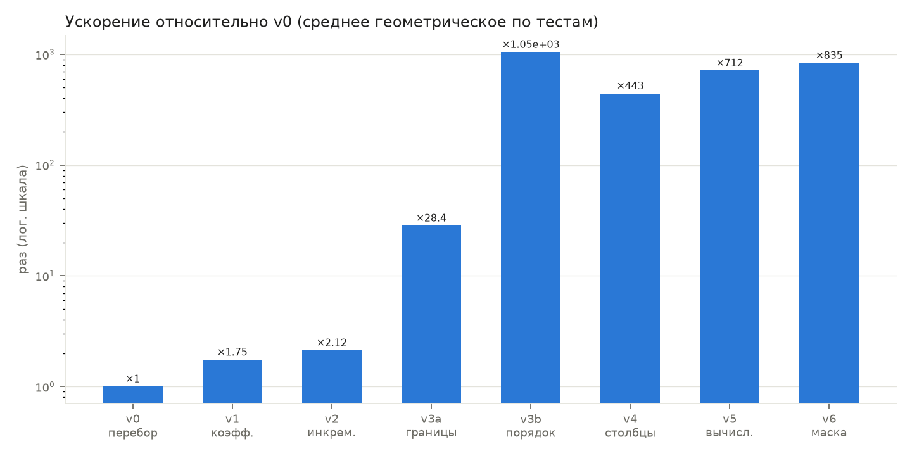
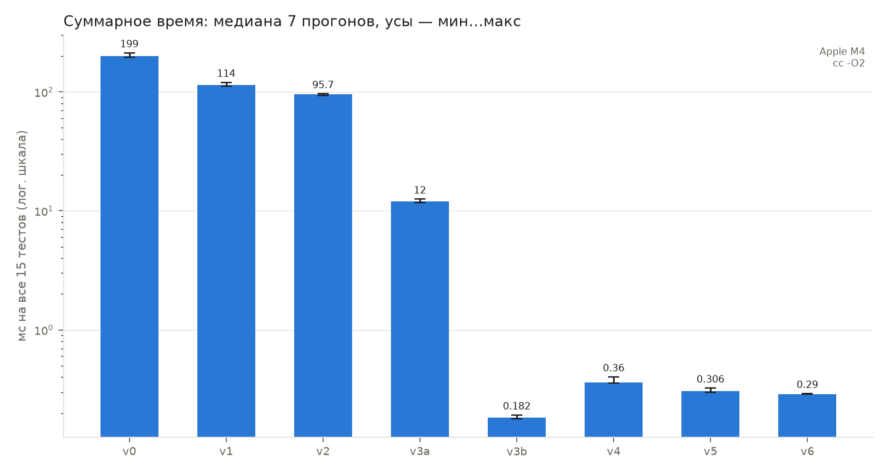
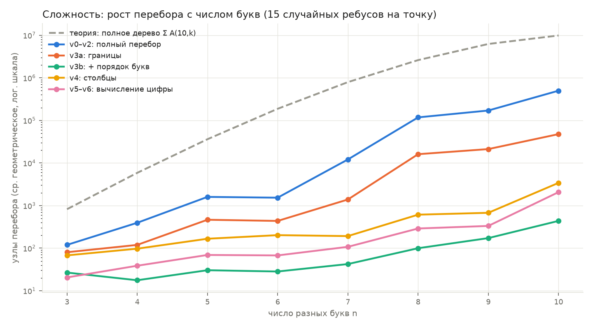
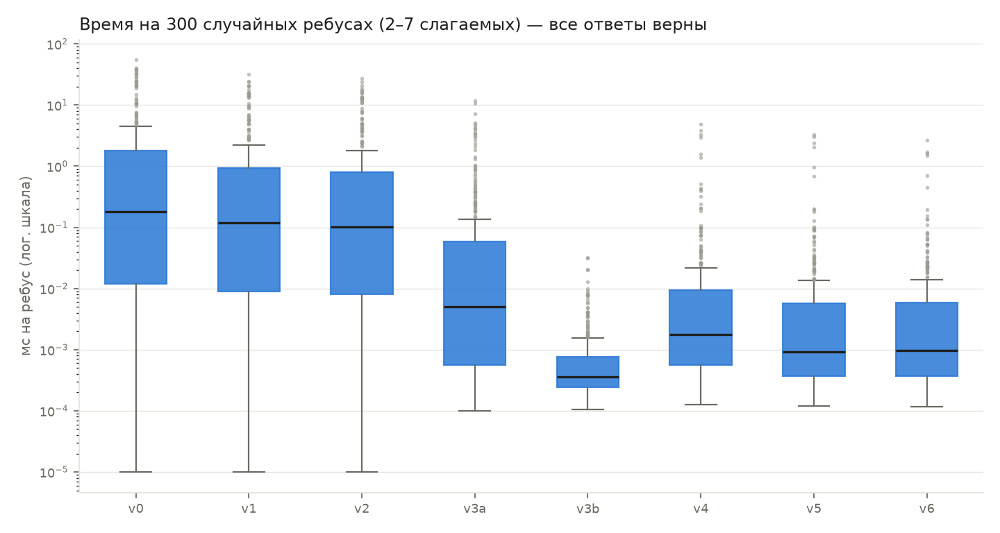
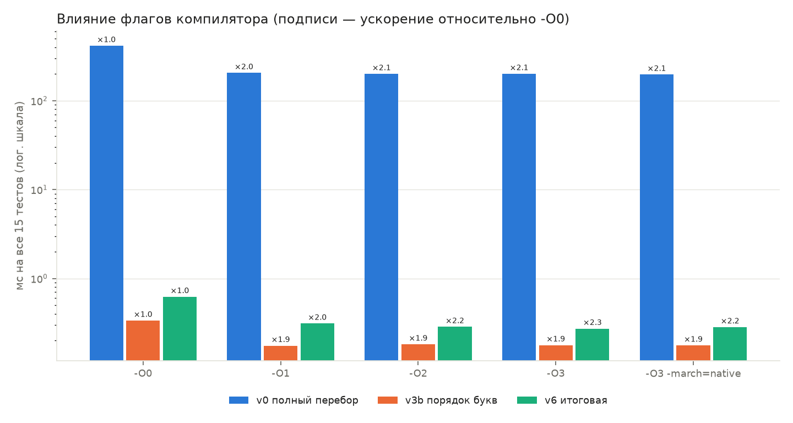

<div align="center">

# Cryptarithm Solver -> Program Optimization lab

Lab 2, variant 1 · SPbPU, Higher School of Cybersecurity
<br/>


<br/>

[Task](#1-task) · [Implementation](#2-implementation) · [Optimizations](#3-optimizations) · [Results](#4-results) · [Complexity](#5-complexity) · [Experiments](#6-additional-experiments) · [Build and run](#7-build-and-run)

</div>

---

## 1. Task

Implement a function that takes a cryptarithm as a string and returns a valid arithmetic expression:

```
Input:  SEND + MORE = MONEY
Output: 9567 + 1085 = 10652
```

Constraints: uppercase letters only, each letter stands for one digit, no leading zeros, addition only, 2 to 7 addends. If a puzzle has several solutions, any one of them is accepted.

Then profile the program, estimate its complexity, apply at least two machine-independent optimizations, one algorithmic optimization and one heuristic (each in a separate commit), and compare performance before and after.

---

## 2. Implementation

The solver is a depth-first search over digit assignments. Shared code lives in `rebus.h`:

- `parse()` — reads the expression; rejects input without `+` between words, a missing `=`, more than 10 distinct letters, fewer than 2 or more than 7 addends;
- `solve()` — the required function: `char *solve(const char *puzzle)`;
- `verify()` — checks every answer independently of the solver;
- `main()` — solves the built-in tests or runs the benchmark.

Each version `vN_*.c` implements only `solve_core()`, the search itself, so any two versions can be compared directly. A node counter (`nodes`, the number of `search()` calls) is kept in every version as a machine-independent measure of work.

---

## 3. Optimizations

Each version builds on the previous one and adds exactly one change.

| Version | Change | Type |
|---|---|---|
| `v0_baseline` | Full search; at each leaf every number is rebuilt from its letters and the sum is checked | baseline |
| `v1_coeffs` | Each letter gets a precomputed weight (±10^position); a leaf computes Σ weight · digit | machine-independent |
| `v2_incremental` | The partial sum is passed down the recursion; a leaf is checked in O(1) | machine-independent |
| `v3_bounds` | Branch and bound: a branch is cut when the remaining letters cannot bring the sum to zero | algorithmic |
| `v3_order` | Letters are assigned in descending order of \|weight\|, so the bound works from the first levels | heuristic |
| `v4_columns` | Column-wise search with carry: a column is checked as soon as all its letters are assigned | algorithmic |
| `v5_forced` | The digit of a result letter is computed as (column sum + carry) mod 10 instead of being enumerated | algorithmic |
| `v6_bitmask` | Used digits are stored in a 10-bit mask; free digits are enumerated with count-trailing-zeros | machine-dependent |

---

## 4. Results

Total time for the 15 built-in puzzles, median of 7 runs, `-O2`.
Apple M4, Apple clang 17 (full details in [`experiments/system.txt`](experiments/system.txt)).

| | v0 | v1 | v2 | v3_bounds | v3_order | v4 | v5 | v6 |
|---|---|---|---|---|---|---|---|---|
| Time, ms | 199 | 114 | 95.7 | 12.0 | 0.18 | 0.36 | 0.31 | 0.29 |
| Speedup | ×1 | ×1.7 | ×2.1 | ×17 | ×1092 | ×553 | ×649 | ×687 |

<div align="center">

<br/>
<sub>Speedup relative to v0, geometric mean over the 15 puzzles.</sub>
<br/><br/>

<br/>
<sub>Total time per version: median of 7 runs, whiskers show min…max.</sub>
</div>

**Observations.**

- v1 and v2 do not change the search tree; they only make a node cheaper (≈2× together).
- The largest gain comes from pruning: bounds alone give ×17, bounds with letter ordering give about ×1000.
- The final version is not the fastest. `v3_order` prunes from the most significant digits, while the column search (v4–v6) has to go from the least significant ones. Columns are faster on puzzles such as `CROSS + ROADS = DANGER` and on long sums with 5–7 addends; ordering is faster where one or two leading digits decide everything.
- v6 visits the same nodes as v5; the gain comes only from a cheaper node.

---

## 5. Complexity

A puzzle with *n* distinct letters has at most A(10, *n*) = 10! / (10 − *n*)! digit assignments, 3 628 800 for *n* = 10. All versions explore the same search tree; they differ in how early a branch is cut and in the cost of one node.

| Version | Worst case | In practice |
|---|---|---|
| v0 | O(A(10, n) · L), L — length of the expression | full tree |
| v1 | O(A(10, n) · n) | full tree, cheaper leaves |
| v2 | O(A(10, n)) | full tree, O(1) leaves |
| v3–v6 | O(A(10, n)) | 2–4 orders of magnitude fewer nodes |

The worst-case bound does not change: in theory pruning can fail on every branch. In practice the number of visited nodes drops sharply, as the measurement below shows.

<div align="center">

<br/>
<sub>Visited nodes vs. number of letters, against the full tree size Σ A(10, k); 15 random puzzles per point.</sub>
</div>

---

## 6. Additional experiments

All produced by `experiments.py`; raw data is in `experiments/`.

**Correctness.** 300 random puzzles with 2–7 addends are generated backwards: random numbers without leading zeros are added, then each digit is replaced by its own letter, so a solution always exists. All 8 versions solve all of them; every answer passes `verify()`.

<div align="center">

</div>

**Compiler flags.** Going from `-O0` to `-O3` speeds every version up by about 2×. The algorithmic changes give about 700× on top of that.

<div align="center">

</div>

**Profiling.**

- macOS: Instruments → Time Profiler, or `xctrace record --template "Time Profiler" --launch -- ./build/v0_baseline -b`
- Linux / MinGW: `cmake -S . -B build-prof -DREBUS_PROFILE=ON && cmake --build build-prof`, run the program, then `gprof build-prof/v0_baseline gmon.out`
- Windows: Visual Studio → Debug → Performance Profiler → CPU Usage

---

## 7. Build and run

Requirements: a C11 compiler (Apple clang, gcc, clang, MSVC 2019 16.8+ or MinGW), CMake 3.10+ (optional), Python 3.8+ with `matplotlib` for the charts.

**macOS / Linux**

```bash
cmake -S . -B build -DCMAKE_BUILD_TYPE=Release
cmake --build build
```

Without CMake:

```bash
mkdir -p build
for v in v0_baseline v1_coeffs v2_incremental v3_bounds v3_order v4_columns v5_forced v6_bitmask; do
  cc -std=c11 -O2 -Wall -Wextra -o build/$v $v.c
done
```

**Windows**

```powershell
# Visual Studio (Developer PowerShell), binaries in build\Release\
cmake -S . -B build
cmake --build build --config Release

# MinGW
cmake -S . -B build -G "MinGW Makefiles"
cmake --build build
```

**Run**

```bash
./build/v6_bitmask                           # solve the built-in puzzles
./build/v6_bitmask "BIG + CAT = LION"        # solve a given puzzle
./build/v6_bitmask -b                        # benchmark
./build/v6_bitmask -b -t 50 -f puzzles.txt   # at least 50 ms per puzzle, puzzles from a file
```

Benchmark output: `puzzle ⇥ ms per solve ⇥ nodes ⇥ OK/FAIL`. The exit code is non-zero if any answer fails verification.

**Charts**

```bash
python3 -m venv .venv && source .venv/bin/activate
pip install matplotlib
python3 bench.py build      # speedup, total time, nodes, time per puzzle
python3 experiments.py      # complexity, random puzzles, repeated runs, compiler flags (~2–5 min)
```

---

## Project structure

```
optimization_1_remastered/
├── rebus.h              parsing, output, verification, tests, timer, main()
├── v0_baseline.c        full search
├── v1_coeffs.c          letter weights
├── v2_incremental.c     incremental sum
├── v3_bounds.c          branch and bound
├── v3_order.c           letter ordering
├── v4_columns.c         column search with carry
├── v5_forced.c          computed result digits
├── v6_bitmask.c         bitmask of used digits
├── CMakeLists.txt       one target per version
├── bench.py             benchmark → plots/
├── experiments.py       additional experiments → experiments/, plots/
├── experiments/         raw data, system.txt
└── plots/               charts
```
